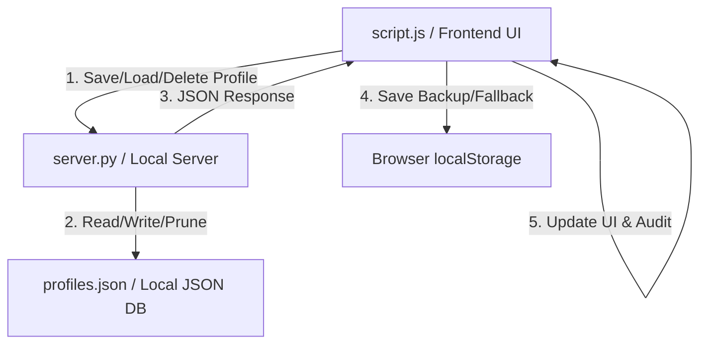

# GT Degree Planner (gt-scheduler)

A web-based tool for planning a 4-year degree schedule at Georgia Tech. It handles AP/DE credit mapping, interactive drag-and-drop scheduling, dynamic degree audits, course catalog imports, and year-by-year planning.

## Features
- **Flexible Schedule Storage:** Schedules are saved locally in the browser's `localStorage` and persist even when switching majors, allowing you to audit the same plan against different degree requirements.
- **Planner Profiles:** Create, load, overwrite, and delete multiple degree planning profiles. Each profile captures the selected major, planned schedule, and AP scores/choices. Features include:
  - Dynamic status feedback messages confirming save, load, and deletion results.
  - Automatic error reporting if server synchronization encounters issues.
- **Suggested Plan Study Reset:** Instantly load or reset your semester grid layout to the official suggested study plan of study for your major (relocated inside the Utilities modal).
- **Dynamic Degree Audit:** Automatically audits completed/planned courses against major requirements, showing checkmarks for satisfied slots and listing unused courses.
- **Drag-and-Drop Scheduling:** Drag courses directly from the requirements checklist or catalog search results into semesters using [SortableJS](https://sortablejs.github.io/Sortable/).
- **AP / Dual Enrollment Credit Mapper:** An interactive side panel (`ap-credits.html`) allows you to input your AP scores and Dual Enrollment credits to automatically map them to Georgia Tech course codes.
- **Dynamic Course Catalog Harvester:** A Python command-line utility (`update_courses.py`) downloads full course details across all ~90 GT subject codes directly from the official Georgia Tech catalog and merges them into the local database (`--all`).
- **Major Requirements & Catalog Link Harvester:** A Python utility (`scrape_majors.py`) extracts degree requirements and official catalog URLs for 204 GT undergraduate majors, providing direct **`🔗 Catalog Page`** links in the UI.
- **Integrated Utilities Menu:** Exposes catalog fetching, profile management, and suggested plans directly inside the browser using a custom server. Includes a clean, compact tabbed layout (Saved Profiles, Suggested Plan, Fetch Catalog) matching the header design to reduce modal height.
- **Clean Responsive Styling:** Beautiful Georgia Tech themed design (Gold, Navy, and White) with collapsible requirement cards, exact course search placeholders, alphabetized major select dropdowns, and full mobile-friendly layouts.

## Architecture & Data Flows

The project is structured to keep database updates and profile syncing decoupled and fast, with browser localStorage serving as a robust fallback for offline runs. Static assets for Cloudflare Workers are served from `./public` to prevent file-watching reloads.



### 1. Database & Profile Layout
- **Course Catalog (`data.js` & `public/data.js`):** Unified database containing course descriptions (`COURSES_DB`), AP/DE credit mappings (`AP_DATA`), and major curriculum requirements (`MAJOR_DATA`).
- **Profile Data Format:**
  ```json
  {
    "name": "My Plan",
    "major": "neuroscience",
    "schedule": { "Fall 2026": ["MATH 1551", ...], ... },
    "apScores": { "Calculus BC": 5, ... },
    "apSelections": { "Calculus BC": "MATH 1551 & MATH 1552" }
  }
  ```

### 2. Profile Synchronization Flow
- **Dual Storage Strategy:** 
  - When the Python server is running, saving a profile sends a `POST` request to `/api/save-profile`, persisting it to a local `profiles.json` file in the project folder.
  - Simultaneously, a backup copy is saved to `localStorage` under `gt_planner_profiles`.
  - If the server is offline or not running, the frontend seamlessly falls back to reading/writing from `localStorage`.
- **Indicator:** An active profile pill badge is displayed in the header controls (e.g., `Profile: Pre-Med Neuroscience`). Clicking this pill opens the utilities modal to the profiles panel immediately.

### 3. Server Endpoints & Utility Scripts
- `server.py`: Custom HTTP server on port 8085 (`python3 server.py 8085`).
- `update_courses.py`: Scrapes GT course catalog pages (`python3 update_courses.py --all`).
- `scrape_majors.py`: Scrapes major requirements and catalog URLs (`python3 scrape_majors.py --all`).

## File Structure
- `index.html`: Main planner layout (checklist side pane, calendar grid, utilities modal, active profile indicator, catalog links).
- `ap-credits.html`: AP Exam Score and Dual Enrollment credit configuration manager.
- `style.css`: Modern styling tokens, layout grids, animations, header controls, and profile list layout designs.
- `script.js`: Core planner state manager, Sortable drag-and-drop binding, dynamic stats formatter, dynamic major select populator, and profile management event loop.
- `data.js`: Unified course database, AP equivalencies, and major curriculum requirements.
- `update_courses.py`: Scraping script that extracts course data from the GT catalog.
- `scrape_majors.py`: Harvester script for GT major degree requirements and URLs.
- `server.py`: Custom HTTP server that integrates the static front-end, catalog-scraping script, and profile storage endpoints.
- `package.json`: NPM scripts (`npm run sync`, `npm run dev`, `npm run deploy`).
- `public/`: Static asset build directory served by Cloudflare Worker (`wrangler dev`).
- `profiles.json`: Git-ignored file-system database of planning profiles.
- `ANTIGRAVITY.md`: Project documentation and architecture guide.

## Running the Project
To start the degree planner locally using the Python server:
```bash
python3 server.py 8085
```
Then open **[http://localhost:8085](http://localhost:8085)** in your web browser.

### Cloudflare Worker Local Dev
To run via Wrangler:
```bash
npm run dev
```
Open **[http://localhost:8787](http://localhost:8787)** in your browser.

---

## ⚠️ NEXT SESSION ACTION ITEMS / TODO (READ ON STARTUP)

> [!IMPORTANT]
> **Priority Tasks for Next Coding Session:**
> 1. **Fix Major Requirements (Biology & Others)**:
>    - Biology degree requirements were previously working correctly and must be carefully reviewed and restored to the exact official GT School of Biological Sciences curriculum layout (Core Biology, Biology Breadth & Depth, Chemistry, Math & Physics, General Core).
>    - Verify requirements parsing across scraped majors to ensure all categories, course codes, and choices match official degree requirements sheets accurately without missing requirements or duplicating slots.
> 2. **Scheduler & Suggested Plan Parsing**:
>    - The scheduler currently relies on a fallback course-level sequencing algorithm for `suggested_semesters`. Update `scrape_majors.py` / degree parser to extract the **exact official suggested plan of study / 4-year schedule** directly from each major's department website / catalog page tables (or departmental advising flowcharts) so that loading the suggested plan renders the department's precise semester-by-semester layout.

